# does-ai-know-you · AI 认识你吗？

<p align="center"></p>

<p align="center">


</p>


**拿客户真正会问的问题，去问 ChatGPT、Claude、Gemini、Perplexity、Grok，以及 DeepSeek、Kimi、通义千问、豆包、元宝，看哪家 AI 会推荐你的品牌。**

[English](README.md)

```bash
npx does-ai-know-you --brand "甜屑 Sweet Crumb" --site sweetcrumb.example \
  --ask "本拿比哪家生日蛋糕好" --ask "best bakery in Burnaby for birthday cakes"
```

> 还没发布到 npm 时，可以直接从 GitHub 运行：`npx github:Hellotravisss/does-ai-know-you --brand …`

## 一个真实结果

[SAVORHILL 山也](https://savorhill.ca)，列治文的烘焙茶饮店，2026 年 10 月由 Avowd 正式测量：20 道客人会问的题（中英文各半，例如「Best bubble tea in Richmond BC」「Where can I buy meat floss cake (肉松蛋糕) in Richmond BC?」），每题在 11 家 AI 上各问两遍，共 440 条回答。

| 引擎 | 提到这家店 | 附上 savorhill.ca 链接 |
| --- | --- | --- |
| ChatGPT | 50% | 47.5% |
| Perplexity | 20% | 20% |
| Claude | 27.5% | 20% |
| Gemini | 42.5% | 27.5% |
| Grok | 47.5% | 37.5% |
| Muse (Meta) | 35% | 0% |
| DeepSeek | 5% | 0% |
| Kimi | 22.5% | 0% |
| Qwen 通义 | 5% | 0% |
| Doubao 豆包 | 5% | 0% |
| Yuanbao 元宝 | 5% | 0% |

经店主同意公开。**中文这几行要仔细看：** 这一轮通义、豆包、元宝是在**没有联网搜索**的情况下回答的（几小时后才开启），DeepSeek 的 API 本身就不能联网。所以这几行反映的是模型自己原本知道多少，而西方引擎都联网搜了。公平的对比要看 11 月那一轮（三家都开了联网），到时我们会更新这张表。

<p align="center"></p>

自己复现其中一部分：

```bash
npx does-ai-know-you --brand "SAVORHILL 山也" --site savorhill.ca \
  --ask "列治文哪家奶茶好喝" --ask "Best bubble tea in Richmond BC" --reps 2
```

## 为什么做这个

大多数「AI 可见度」工具，包括免费的 SEO 插件，都是看你的网站「像不像会被引用」，然后打个分。那是猜的。这个工具直接去问 AI，原话照录。

而且几乎没有工具去问**中文 AI**。你的客人里只要有人用中文问，DeepSeek、Kimi、通义、豆包、元宝就是他们问的地方。它们认不认识一家北美商家，现在你可以自己查，不用再猜。

## 它做什么

- 把每个问题发给你有 key 的每一家 AI，**开着联网搜索**。调用方式、模型、参数和 [Avowd 青眼](https://avowd.ai) 每月正式测量用的完全一样
- 回答里出现你的名字、双语名字的任意一半（「甜屑」或「Sweet Crumb」）、你的域名，或你用 `--alias` 给的别名，就算提到你
- 另外单独统计 AI 有没有**附上你网站的链接**。被提到和被引用是两回事
- **每一条回答、每一个引用链接**都存进 `answers.jsonl`，另有 `report.md` 和 `result.json`。没法复核的数字，就不该信
- 问题里如果带了你自己的品牌名，会提醒你。「Acme 是什么」只能说明 AI 读得懂你的官网；「附近哪里买 X」才能说明 AI 会不会把你推荐给一个从没听说过你的人。只有后者有价值

## API key

用你自己的 key，放在环境变量里，或运行目录下的 `.env` 文件。有几家填几家，没有 key 的自动跳过。变量名见[英文说明](README.md#keys)。

国内账号的 Kimi、通义：设 `KIMI_URL=https://api.moonshot.cn/v1/chat/completions`，或 `QWEN_URL=https://dashscope.aliyuncs.com/compatible-mode/v1/chat/completions`。

费用：用你自己的 key，每条回答不到 1 美分到几美分。Grok 和 Perplexity 最贵，因为它们每次要读很多网页。

## 在 Claude Code 里用

把 `skill/` 文件夹复制到 `~/.claude/skills/does-ai-know-you/`，然后对 Claude 说：「AI 认识我的面包店吗？我们叫甜屑，在本拿比，网站 sweetcrumb.ca」。Claude 会用中英文按客人的口吻起草问题、跑检测，再给你解读结果。

## 怎么看结果才不自欺

- **跑一次只是一张快照。** 同一个问题每次答得都不一样，每周也在变。下结论前至少用 `--reps 2`，比较要按月比，不是按分钟比
- **几道题不算测量。** 20 道题、每家 AI 问两遍、题目固定不变、每月一次，才叫测量。这正是 Avowd 每月在做的
- **问题里永远不要带你的品牌名**

## 出自 Avowd 青眼

[Avowd 青眼](https://avowd.ai) 每月在中西方 11 家 AI 引擎里测量品牌被推荐的情况，并且动手去做那些真正能改变结果的工作，其中大部分在你的网站之外。测量方法公开在 [avowd.ai/method](https://avowd.ai/method)。

MIT 开源协议。
